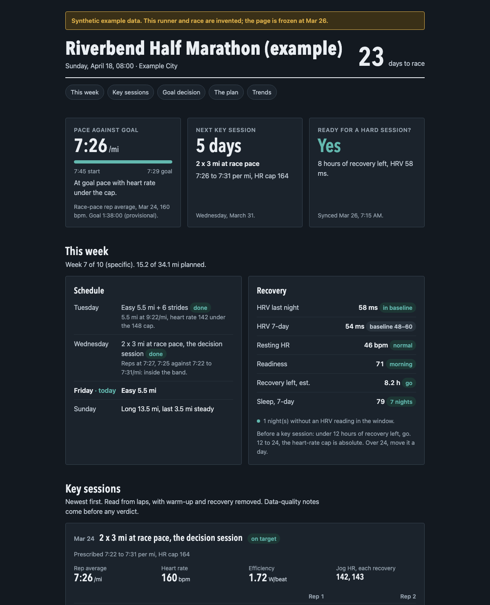

# Strider

An AI running coach for runners with a Garmin watch. Claude builds a training block for your race (5K to marathon) as one plan file, puts the workouts on your watch, judges every run from its laps, and keeps a dashboard current. You decide the goal; the plan's rules are written down before they are needed.



*The runner and race in the screenshot are invented. See [examples/](examples/).*

## What you get

- **A profile built from your own history.** Heart-rate zones, pace bands from sessions you actually ran, HRV baseline, and how far your watch over-reads distance.
- **A block for your race and your week.** Block length, session types, long-run growth, taper and fueling depend on the distance. Every hard session has a pace band and a heart-rate cap.
- **One plan file.** Garmin workouts, calendar events and the dashboard are generated from `plan.json`. Changing the goal is one edit and a regenerate.
- **Runs judged from laps.** Rep pace, heart rate, power fade, recovery heart rate, efficiency, ground contact and cadence, with data-quality checks before any verdict.
- **Rules instead of improvisation.** A go/no-go rule before hard sessions, and a goal-setting rule that covers every outcome and waits for your yes.
- **Race week, race review, and a recovery check** before training resumes.
- **A dashboard that opens from a file.** No account, no server, no network requests.

## Quickstart

You need: a Garmin watch that syncs to Garmin Connect, [Claude Code](https://claude.com/claude-code) or the Claude desktop app, Python 3.9 or newer, and [uv](https://docs.astral.sh/uv/) (for the Garmin server).

1. **See it first.** Clone this repository and open `dashboard/index.html` in a browser. It shows a synthetic half-marathon runner. Add `?example=10k` to the address for the other example.

2. **Connect Garmin.** Sign in once, then add the server to Claude (details in [Garmin setup](#garmin-setup)):

   ```bash
   uvx --python 3.12 --from git+https://github.com/Taxuspt/garmin_mcp garmin-mcp-auth
   ```

3. **Install the plugin.** In Claude Code:

   ```
   /plugin marketplace add wadefuller/strider
   /plugin install strider@strider
   ```

   Or skip the plugin and copy the Markdown files in `skills/` into your own setup; they are plain text.

4. **Make a training folder and build your profile.** Create an empty folder for your own data (it will hold health data, so keep it private), open Claude there, and say: *"Set up my running profile."* Claude reads your Garmin history and asks a handful of questions.

5. **Build your block.** *"Build a plan for the <race> on <date>, goal <time>."* Claude drafts the plan, shows it to you, then puts the workouts on your watch and writes the dashboard to `dashboard/index.html` in your folder.

After that: *"I ran today"* after a run, *"weekly review"* at the end of the week, *"what's my workout today"* on a hard day.

## Garmin setup

Strider talks to Garmin through [Taxuspt/garmin_mcp](https://github.com/Taxuspt/garmin_mcp), an open-source MCP server (MIT licence). It is a separate project that you install; none of its code is included here.

1. Authenticate once (command above). Your email, password and any MFA code go to Garmin from your machine. Tokens are saved in `~/.garminconnect` and last about six months.
2. Add the server to your Claude configuration, without credentials:

   ```json
   {
     "mcpServers": {
       "garmin": {
         "command": "uvx",
         "args": ["--python", "3.12", "--from", "git+https://github.com/Taxuspt/garmin_mcp", "garmin-mcp"]
       }
     }
   }
   ```

3. Restart Claude and ask *"what was my last run?"* to confirm it works.

**Make it reliable.** The connection is the weakest part of the system: the server runs on your computer, so it stops when the computer sleeps, and a tool call can wait unseen on an approval prompt.

- Pre-allow the read-only tools so nothing stalls. In your training folder's `.claude/settings.json`:

  ```json
  {
    "permissions": {
      "allow": [
        "mcp__garmin__get_activities_by_date", "mcp__garmin__get_activity_splits",
        "mcp__garmin__get_activity_typed_splits", "mcp__garmin__get_activity",
        "mcp__garmin__get_activity_weather", "mcp__garmin__get_hrv_trend",
        "mcp__garmin__get_hrv_data", "mcp__garmin__get_sleep_summary_range",
        "mcp__garmin__get_rhr_day", "mcp__garmin__get_training_readiness",
        "mcp__garmin__get_recovery_time_remaining", "mcp__garmin__get_vo2max_trend",
        "mcp__garmin__get_lactate_threshold", "mcp__garmin__get_user_profile",
        "mcp__garmin__get_unit_system", "mcp__garmin__get_scheduled_workouts",
        "mcp__garmin__get_workout_by_id"
      ]
    }
  }
  ```

  Leave the write tools (`upload_workout`, `schedule_workout`, `unschedule_workout`) on ask until you trust the setup.
- Schedule a daily sync so the dashboard is never more than a day old. The dashboard says so in red when its data is older than 26 hours.
- If Garmin cannot be reached, Claude stops and asks for a screenshot of the lap table instead. It does not update anything from a guess.

The exact tools Strider calls, and the fallback procedure, are in [reference/garmin.md](reference/garmin.md).

## How the pieces fit

```
          Garmin Connect  <──────────────────────────────┐
                │  read (garmin_mcp)                     │ upload + schedule workouts
                ▼                                        │
   athlete.md ──┐                                        │
                ├──>  plan.json  ──┬──> workouts/*.json ─┘
   your race ───┘   (source of     ├──> calendar events, or plan.ics
   and week          truth)        └──> dashboard/data.js ──> dashboard/index.html
                         ▲
                         │  statuses, actuals, log
   data/raw/*.json ──> coach.py sync  (laps → reps → checks → verdicts)
```

| Skill | When | What it does |
|---|---|---|
| [`setup`](skills/setup/SKILL.md) | once, and after each block | Builds `athlete.md` from Garmin history; asks only what cannot be derived |
| [`build-block`](skills/build-block/SKILL.md) | per race | Drafts, validates and shows the plan, then generates every surface |
| [`log-run`](skills/log-run/SKILL.md) | after runs | Pulls laps, judges sessions, applies rules, updates everything, sweeps for stale values |
| [`weekly-review`](skills/weekly-review/SKILL.md) | weekly, or scheduled | Planned against run, recovery trend, next week |
| [`session-brief`](skills/session-brief/SKILL.md) | hard days, or scheduled | Go/no-go, exact targets, watch check, one cue |
| [`race-week`](skills/race-week/SKILL.md) | 7 and 2 days out | Goal confirmed, pace chart at course markers, forecast, kit, timeline |
| [`race-review`](skills/race-review/SKILL.md) | after the race, and 4 days later | Race analysis from laps, chip time, recovery check |

Shared rules live once in [`reference/`](reference/) and the skills point to them: [data-quality checks](reference/data-quality.md), [decision rules](reference/decision-rules.md), [propagation checklist](reference/propagation.md).

The tools are plain Python with no third-party dependencies:

```bash
python3 tools/coach.py validate examples/10k/plan.json
python3 tools/coach.py chart examples/half-marathon/plan.json
python3 tools/coach.py sync examples/10k/plan.json --raw examples/10k/raw --out /tmp/demo --now 2027-04-23T08:00:00
```

Run the tests with `uv run --with pytest --with jsonschema --with pyyaml pytest`.

Background reading: [how sessions are chosen, with sources](docs/methodology.md) and [what each metric means and which decision it changes](docs/metrics.md).

**Optional surfaces.** Google Calendar (or any calendar connector) is optional; without one, Strider writes `plan.ics` for you to import. Publishing the dashboard as a Claude artifact is optional too; the file works on its own. Units are a profile setting: the plan stores metric values and displays kilometres or miles.

## Limits

- **Distances.** Road 5K, 10K, half marathon and marathon. Not ultras, trail or mountain races, triathlon, track racing under 5K, walking plans, or return-from-injury programmes.
- **Field testing.** The system was developed over one real half-marathon block. The 5K, 10K and marathon templates are built from published coaching sources and have not yet been through a full block with this system. Treat them as a first draft.
- **Who it is for.** Healthy adults who already run regularly. It is not a beginner programme.
- **Garmin only**, through an unofficial API (below). Running power and form metrics need a watch that records them; everything degrades to pace and heart rate without them.
- **The lap-analysis tools were rewritten for this release** from the behaviour of the original private scripts, and are covered by tests against synthetic laps. Garmin workout upload follows the server's documented format but has been exercised less than the read path.
- **Per-second form analysis** needs the optional `fitparse` package and a downloaded `.fit` file.
- Claude is doing the coaching. It follows the rules in this repository, but it can still be wrong. The checks exist because it was.

## Disclaimers

- **Not medical advice.** Strider is a training aid, not a doctor, physiotherapist or dietitian. Get medical clearance before hard training if you have any doubt about your health, and see a clinician for pain that changes how you run, chest symptoms, or illness. Heart-rate and HRV readings from a watch are estimates.
- **Unofficial Garmin API.** garmin_mcp uses an unofficial interface to Garmin Connect. It can break without notice, and using it is at your own risk under Garmin's terms. Strider is not affiliated with or endorsed by Garmin or Anthropic.
- **Your credentials stay on your machine.** Sign-in happens between your computer and Garmin; tokens are stored locally by garmin_mcp. Strider never asks for, stores or transmits them. Your training folder holds health data: do not commit it to a public repository. The `.gitignore` here excludes the usual file names as a backstop.

## Acknowledgements

- [Taxuspt/garmin_mcp](https://github.com/Taxuspt/garmin_mcp) and [python-garminconnect](https://github.com/cyberjunky/python-garminconnect), which make the Garmin connection possible.
- The `training-intel` plugin by Jamie, whose idea of a single athlete profile file that every skill reads first is where this started. No text from it is included here.
- The coaches and researchers cited in [docs/methodology.md](docs/methodology.md).

## Licence

MIT. See [LICENSE](LICENSE).
